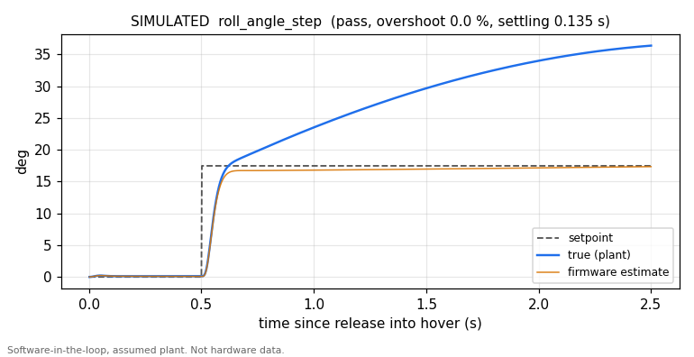

# emb-drone-flight-stack

> **Status: hardware design complete. Firmware written, tested on a host, run
> in simulation and on an emulated MCU but never run on hardware.**
> The 6-layer flight controller is designed through to fabrication-ready Gerbers
> and assembly files. The firmware passes 259 host-side tests, flies a simulated
> quadrotor in software-in-the-loop and its real STM32F405 image boots and runs
> its control loop under Renode. The boards have not been assembled, powered or
> flown, so not one line of it has executed on silicon. Every number below comes
> from a script in this repository and is either a host test result, a
> simulation or an emulation; none is a measurement. See [STATUS.md](STATUS.md)
> for the precise breakdown of what does and does not exist.

Design files imported from [`OpenSourceDrone`](https://github.com/CGainsWorks/OpenSourceDrone),
which remains the original working repository.

A quadrotor flight-controller PCB that integrates the power stage with an
STM32F405, plus C++20 firmware written from scratch (not a Betaflight fork):
attitude estimation, a cascaded PID attitude loop, a quad-X mixer, IMU,
barometer, magnetometer and GPS drivers, PWM ESC output, DShot frame encoding,
CRSF receiver and telemetry, plus arming and failsafe logic.



*Simulated: the firmware's own control code flying an assumed quadrotor model on
a host (`firmware/sim/sil`). Not hardware data. The gap between the blue and
orange traces is a real finding, described under [Findings](#findings-from-simulation).*

## Verification without hardware

No board exists yet, so each layer is checked on a normal PC and in CI
(`.github/workflows/ci.yml`):

| Layer | What runs | Tooling | Result |
|---|---|---|---|
| Host unit tests | Portable core against HAL mocks, including a bit-level SPI slave model | CMake, g++ | 17 suites, 259 tests, 186,608 assertions, 0 failures |
| Software in the loop | Unmodified `FlightController`, IMU driver, PID, mixer and arming logic closed around a rigid-body quad with motor lag, output latency, sensor noise and a disturbance torque | `firmware/sim/sil`, `tools/pid_tuner.py` | 5 step scenarios within limits on a nominal and a perturbed plant (simulated) |
| Emulated MCU | The real `fc_firmware.elf` on Renode's STM32F4 platform, with a simulated ICM-42688-P decoding the firmware's bit-banged SPI from the GPIO pins | Renode 1.16.1, Robot Framework | 4 tests: boot text, IMU bring-up, control loop, estimator follows a simulated tilt (emulated) |
| Linked image | Vector table, stack pointer, reset vector, USART1 slot, hard-float ABI | Arm GNU Toolchain 13.3.rel1, `verify_image.sh` | all checks pass |

```bash
cd firmware && ./run_tests.sh                    # host tests, no hardware needed
python3 tools/pid_tuner.py run                   # simulated step responses into test-results/sil
python3 tools/pid_tuner.py check test-results/sil/metrics.json
cd firmware && ./build_firmware.sh               # STM32F405 image, needs arm-none-eabi-gcc
renode-test firmware/sim/renode/fc_firmware.robot   # needs the image and Renode
```

`tools/pid_tuner.py` needs only the standard library, except `plot`, which
needs `pip install -r tools/requirements.txt`.

### Simulated step responses

From `test-results/sil/metrics.json`, generated by `fc_sil` with the firmware's
default gains. Limits were set as requirements before tuning and are what CI
gates on. Rate steps are judged on the true body rate; angle steps on the
firmware's attitude estimate, which is the quantity the angle loop controls.

| Scenario | Step | Overshoot | Settling (5 %) | Steady error | Limits |
|---|---|---|---|---|---|
| Roll rate | 51.6 deg/s | 4.7 % | 0.031 s | 3.0 % | 25 %, 0.25 s, 5 % |
| Pitch rate | 51.6 deg/s | 0.0 % | 0.035 s | 0.2 % | 25 %, 0.25 s, 5 % |
| Yaw rate | 57.3 deg/s | 19.1 % | 0.205 s | 3.0 % | 25 %, 0.5 s, 5 % |
| Roll angle | 17.5 deg | 0.0 % | 0.135 s | 1.0 % | 20 %, 1.0 s, 5 % |
| Pitch angle | 17.5 deg | 0.0 % | 0.156 s | 1.2 % | 20 %, 1.0 s, 5 % |

On the perturbed plant (motor time constant 45 ms instead of 30 ms, inertia
+30 %) the same gains also pass, with overshoot up to 21.7 % on yaw. The plant
parameters (0.65 kg, 0.11 m arms, 9 N per motor and so on) are assumptions for a
generic 5-inch 4S quad, recorded in `firmware/sim/sil/quad_plant.hpp`; none was
measured on this airframe.

The default gains came from `python3 tools/pid_tuner.py tune --start
tools/placeholder_gains.json`, starting from the untuned placeholders the
firmware used to ship with; the search is recorded in
`test-results/sil/tuning.json`. The result was rounded and the yaw P term eased
by hand from 154 to 130 for overshoot margin. They are simulation-tuned starting
values for bench tuning, not flight-proven gains.

### Findings from simulation

- **The mixer had the pitch axis inverted.** The quad-X table raised the rear
  motors for a nose-up command. With the documented motor layout that is
  positive feedback and the SIL airframe diverged in pitch within 0.3 s of
  release. The existing unit tests had encoded the same mistake. Fixed, and
  `test_sil` now checks the mixer's moments against independent rigid-body
  physics.
- **Angle mode drifts under a held tilt.** The accelerometer on a multirotor
  sees thrust, not gravity, so while a tilt is held the Mahony correction pulls
  the estimate towards level. In the roll angle step the estimate holds
  17.5 deg while the true angle reaches 36.4 deg two seconds after the step.
  There is no velocity aiding (GPS or optical flow) in the estimator to correct
  it. `test_sil` pins the effect so a change to it is noticed; fixing it is open
  work.

## Firmware

| | |
|---|---|
| [`firmware/README.md`](firmware/README.md) | Architecture, build and test, simulation and emulation, plus what is deliberately not implemented |
| [`firmware/docs/PINOUT.md`](firmware/docs/PINOUT.md) | The pinout as extracted from the PCB netlist, including why the IMU cannot use hardware SPI1 on this board |
| [`firmware/docs/BRING_UP.md`](firmware/docs/BRING_UP.md) | Bring-up procedure with expected values. Not yet performed |

## Hardware

- `hardware/flight-controller/`: the `FCSTMV1.05` 6-layer board in KiCad, with
  Gerbers, drill files, BOM, interactive BOM, pick-and-place and the
  controlled-impedance stackup.
- `hardware/esc/` and `hardware/rf/`: ESC, control link and video link
  schematics (PDF).

A separate power distribution board is not designed.

## Build checklist

Anything requiring a powered board is unchecked, because no board has been
powered.

- [ ] PDB schematic and layout
- [ ] PDB fabrication and bench validation: efficiency, thermal, protection
- [x] Flight controller schematic with MCU pin-mux plan
- [x] Flight controller layout with a defined stackup
- [ ] Fabrication and bring-up checklist executed: procedure written
      ([firmware/docs/BRING_UP.md](firmware/docs/BRING_UP.md)), not performed
- [ ] IMU driver over SPI with verified data: driver written and tested against
      simulated devices on the host and on the emulated MCU; no data from real
      silicon
- [x] Attitude estimator with host-side unit tests
- [ ] PID attitude loop with step-response tuning on a test rig: tuned in
      simulation only; never driven a motor
- [ ] PWM and DShot ESC output: PWM implemented; DShot frame encoding
      implemented and tested but its timer DMA is not wired up
- [ ] Barometer, magnetometer and GPS: drivers written and tested against
      simulated devices; no STM32 I2C driver yet and on this board revision
      the magnetometer and GPS do not reach the F405
- [ ] UART telemetry and ground-station plotting: telemetry implemented; no
      ground-station tool yet
- [ ] Loop timing budget measured: the firmware measures and reports its own
      loop timing; only an emulator has run it and emulated timing says
      nothing about silicon
- [ ] Tethered hover
- [ ] Free flight and logged flight data

## Licence

MIT, see [LICENSE](LICENSE).
